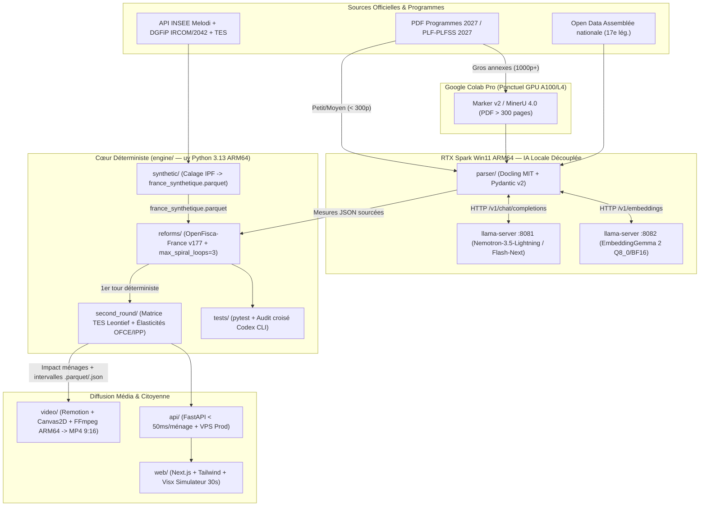
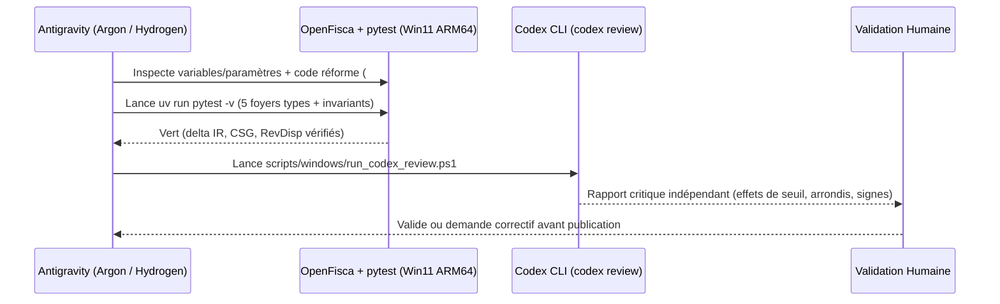

# 01 — Architecture Système (Local RTX Spark ARM64 vs Colab Pro vs Prod VPS)

## 1. Principes d'Architecture

L'architecture de **VeriteFiscale-2027** repose sur trois invariants non négociables :
1. **Exécution native Windows 11 ARM64 sur RTX Spark** (`uv`, Python 3.13 `win_arm64`, Node.js ARM64, `llama-server.exe`), sans WSL2 ni conteneurs Linux par défaut.
2. **Découplage strict entre IA et Calcul Déterministe** :
   - Les LLM et modèles d'embeddings (`llama-server.exe` sur `8081`/`8082`) sont confinés dans `parser/` pour lire les PDF, citer les phrases exactes avec numéro de page et proposer des correspondances OpenFisca.
   - Le moteur `engine/` (Python pur + NumPy/NumExpr/Polars/DuckDB + `OpenFisca-France`) ne contient aucune dépendance PyTorch/vLLM et calcule tous les résultats à l'euro près de manière reproductible.
3. **Format pivot immuable `.parquet` & `.json`** : le moteur `engine/` exporte des tables `.parquet` (lues nativement par `polars` et `duckdb` sans `pyarrow` sur `win_arm64`) et des résumés `.json` consommés à l'identique par `api/`, `web/` et `video/`.

---

## 2. Diagramme Global des Flux de Données

---

## 3. Séparation des Environnements d'Exécution

| Environnement | Matériel / Cible | Rôle exclusif | Paquets clés | Interdictions |
| :--- | :--- | :--- | :--- | :--- |
| **Local `engine/`** | RTX Spark CPU ARM64 (`uv` Py 3.13) | Micro-simulation OpenFisca, IPF, TES, `pytest` | `openfisca-france`, `polars`, `duckdb`, `pydantic`, `pytest` | PyTorch, vLLM, TensorFlow, `pyarrow` |
| **Local `parser/`** | RTX Spark ARM64 + `llama-server` CUDA | Extraction PDF Docling, RAG OpenFisca, structuration JSON | `docling`, `httpx`, `pydantic`, `duckdb` | Calculer des montants fiscaux via LLM |
| **Local `video/`** | RTX Spark Node.js ARM64 + FFmpeg ARM64 | Rendu vidéo TikTok/Reels/Shorts 1080×1920 60fps | `remotion`, `react`, `canvas2d` | Appeler l'API OpenFisca pendant le rendu frame-by-frame |
| **Colab Pro** | Cloud GPU A100/L4 (ponctuel) | OCR massif Marker/MinerU sur gros annexes PLF (1 000+ pages) | `marker-pdf`, `magic-pdf` | Exécuter OpenFisca |
| **VPS Prod (`api/` + `web/`)** | Linux/ARM64 ou x86_64 hébergé | Simulateur citoyen < 50 ms/requête | `fastapi`, `uvicorn`, `openfisca-france`, `nextjs` | Embarquer un LLM local en production |

---

## 4. Pipeline de Validation Continue (`Google code / OpenAI vérifie`)

