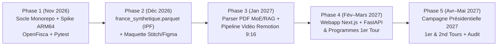

# ROADMAP — VeriteFiscale-2027 (Novembre 2026 → Mai 2027)

## Vue d'ensemble des jalons

---

## Détail Mois par Mois

### M1 — Novembre 2026 : Socle, Environnement ARM64 & Premiers Chiffrages PLF/PLFSS 2027
- [x] Initialisation du monorepo, `AGENTS.md`, `DESIGN.md`, `docs/` et scripts Windows 11 ARM64 (`uv` Python 3.13 `win_arm64`).
- [x] Résolution des contraintes `win_arm64` (`polars`/`duckdb` à la place de `pyarrow`, contournement `MAX_PATH` `\\?\` et `max_spiral_loops=3` sur OpenFisca).
- [x] Premier spike fonctionnel & suite `pytest` (`engine/reforms/demo_plf2027_retraites.py`) validés + revue `codex review`.
- [ ] Indexation complète des 3 183 variables `openfisca-france` avec `EmbeddingGemma 2` (`8082`) via `parser/index_openfisca_docs.py`.
- [ ] Codage des 3 premières mesures phares du **PLF / PLFSS 2027** (ex: barème IR, fiscalité retraites, allègements généraux).

### M2 — Décembre 2026 : Population Synthétique (`IPF`) & Design System (`Stitch → Figma`)
- [ ] Connecteur Open Data `api.insee.fr/melodi` + ingestion Filosofi + DGFiP IRCOM/2042 + Budget de Famille COICOP.
- [ ] Génération et validation macroéconomique de `data/processed/france_synthetique.parquet` (10 000+ ménages pondérés).
- [ ] Implémentation du module déterministe `engine/second_round/` (fiscalité indirecte COICOP + matrice TES niveau A38).
- [ ] Maquettage Stitch → Figma des composants partagés (`Ticket de Caisse`, `Nuage 10k points`, `Tampons 🟢/🟡/🔴`).

### M3 — Janvier 2027 : Usine Vidéo Remotion (`video/`) & Pipeline d'Extraction PDF (`parser/`)
- [ ] Initialisation de `video/` (Remotion + React + Canvas2D + `npx skills add remotion-dev/skills`) avec rendu 1080×1920 60fps via FFmpeg `winarm64`.
- [ ] Pipeline complet `parser/` (Docling + `Nemotron-3.5-Lightning-30B-A3B` / `Qwen3.8-Flash-Next` + Colab `Marker v2`) produisant des fiches JSON sourcées page par page.
- [ ] Production et publication des **5 premières vidéos pilotes** sur les mesures PLF/PLFSS 2027.

### M4 — Février–Mars 2027 : Simulateur Citoyen Web (`api/` + `web/`) & Programmes Officiels
- [ ] Backend `api/` FastAPI (< 50 ms par foyer type/citoyen) avec cache mémoire/Polars et exposition du code AGPL-3.0.
- [ ] Frontend `web/` Next.js + Tailwind + Visx : simulateur mobile en 30 secondes + générateur de cartes OG partageables.
- [ ] Encodage, tests `pytest` et audit croisé `codex review` de tous les programmes présidentiels déposés (1 fiche Python par mesure).

### M5 — Avril–Mai 2027 : Sprint Électoral Présidentielle 2027 (1er & 2nd Tours)
- [ ] Comparateur multi-candidats 1er tour (vue ticket personnel + nuage des 10 000 ménages par programme appliqué à 100 %).
- [ ] Mise à jour des débats d'entre-deux-tours en < 24 h grâce au pipeline `parser/` -> `engine/` -> `codex review` -> `video/`.
- [ ] Publication complète des jeux de tests, cahiers d'hypothèses et bilan post-élection en open-source.
